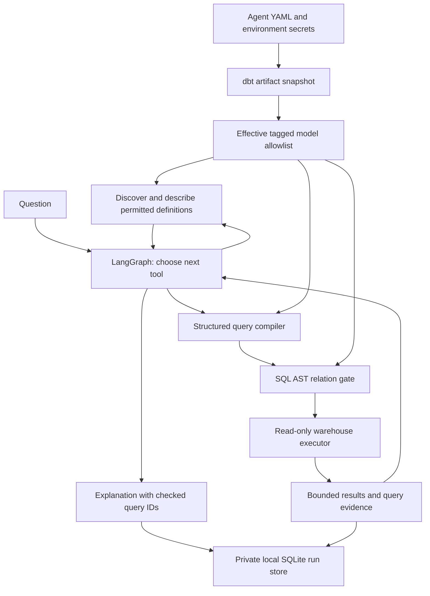

# Design and scope

Semtrail is a single-operator harness with a React/Tailwind workspace, HTTP API and
stdio MCP bridge, all backed by the same application service.
The initial implementation chooses Python and LangGraph as requested. One reusable
`DataAgent` powers domain agents with separate instructions, policies and credentials.

## Modules

| Module | Responsibility |
|---|---|
| catalog | Read supported dbt artifacts; normalize model identities and descriptions |
| policy | Compile tags into an allowlist, deny takes precedence |
| semantics | Compile an explicit subset of named dbt metrics |
| query | Validate typed requests, compile parameterized SQL, validate SQL AST |
| warehouse | Execute read-only against DuckDB or PostgreSQL |
| agent | Actual LangGraph investigation, tool dispatch, budgets and answer checks |
| providers | Instantiate optional provider adapters with environment secrets |
| evidence | Save questions, SQL, bounded results and final explanations |
| demo | Reproducible data and deterministic fixture model for offline verification |
| service | Shared configured-agent registry and bounded investigation dispatch |
| server | HTTP API, local access boundary and static React frontend |
| mcp_server | Stdio integration with MCP clients |

## Deliberate tradeoffs

- **Compiled artifacts instead of repository execution.** Users own Git checkout,
  dbt build and refresh. This avoids dependency on dbt in the runtime and avoids
  running repository hooks with agent credentials.
- **Structured queries instead of arbitrary model-generated SQL.** The supported
  single-model surface is inspectable and deterministic. SQL is still exposed as evidence.
- **Small native metric compiler.** The initial proposal suggested MetricFlow. The
  implementation instead supports a narrow, tested dbt semantics subset without its
  dependency tree. A MetricFlow adapter is future work, not a hidden fallback.
- **Provider adapters instead of a hosted gateway.** OpenAI-compatible and Anthropic
  adapters use the user's API keys directly. Other LangChain tool-calling models can
  be injected through the Python API.
- **Local evidence instead of a tracing dependency.** SQLite holds completed runs.
  It is not a durable LangGraph checkpointer: crash resume, concurrent writes across
  distributed workers, and shared multi-user sessions are outside this release.
- **Honest limits.** Unsupported metric semantics fail; citation checks don't prove
  factual entailment; row/column security remains in the warehouse.

## Extension points

Implement `Warehouse.execute` for another database dialect and add matching SQL-gate
tests. Implement `MetricCompiler.discover/compile` for another semantic compiler,
ensuring authorization covers every dependency. The present gate rejects CTEs and
joins, so a MetricFlow adapter will also need a carefully tested gate extension.
Pass a compatible model exposing `bind_tools` and `invoke` for another LLM provider.
Do not give the LLM the database connection or bypass the final execution gate.

## Deferred

GitHub OAuth, hosted compute, multi-tenancy, role management, schedules,
Slack channels, vector retrieval, cross-model joins, advanced metrics, durable
crash recovery, automatic dbt changes and additional warehouse adapters.
